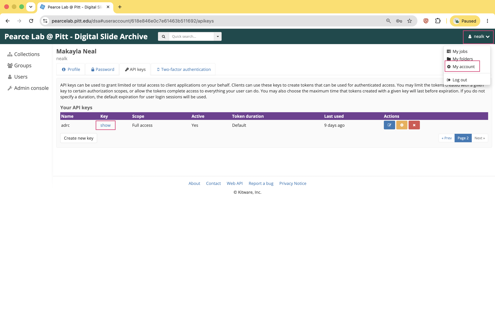

# Remote HistomicsUI (rHUI)

rHUI is a commands line program that runs analyses traditionally done in Histomics UI remotely via the Digital Slide Archive's (DSA) API. 

## Installation

**Environment Requirements:**
- girder-client
- geojson

1. Clone Repository
```
git clone https://github.com/kaylaneal/rHUI
cd rHUI
```

2. Run
```
python run.py --config config.json --analyses NFT-detection
```


## Usage

Running requires a configuration file. Examples can be found [here](/example_config/)

**Minimum Configuration File Requirements:**
- Global Parameters Dictionary
    - dsa_server_url
    - dsa_api_key
    - root_folder_id
        - id of the folder containing the image files
        - *empty string for single run with batch set to false*
    - item_id
        - item name or the id of the .svs file
        - *notably this is NOT the id of the DSA item, but the item file*
    - batch
        - `true` or `false`
- Analysis Parameters Dictionary
    - varies based on analysis, parameters can be found on HistomicsUI 

**Available Analyses:**
- NFT-detection via [jvizcar/neurotk docker image](https://hub.docker.com/r/jvizcar/neurotk)


## Troubleshooting

- Where is my API key?
    - API keys are listed under the user account menu
    - Existing API keys can be copied by clicking on 'show' and then selecting the key from the dialog pop up.
    - A new API key can be created by clicking on 'Create new key' and following the prompts. 
        - Upload and Read access is required.
    

